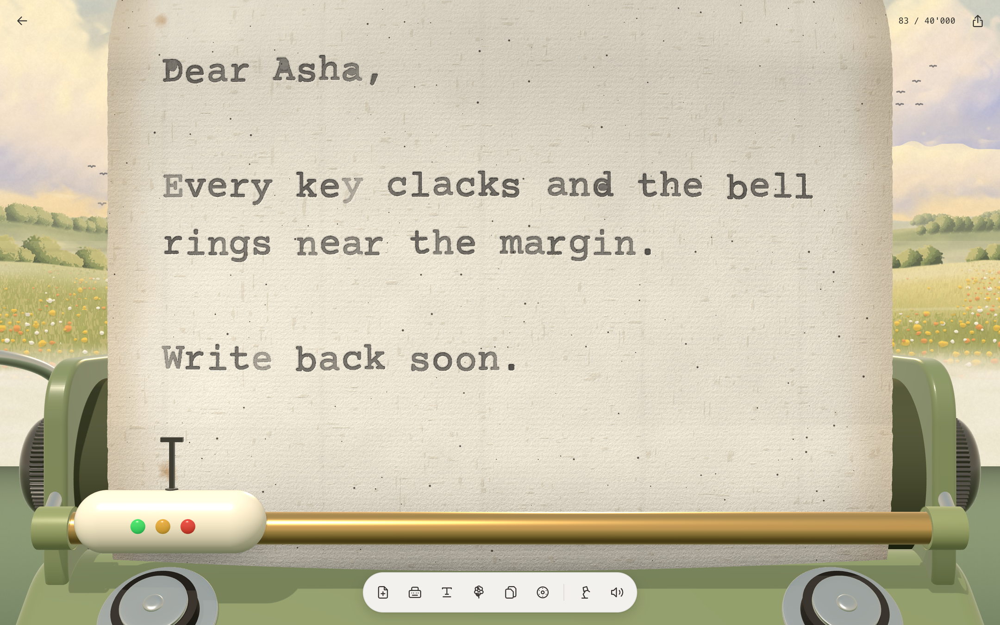
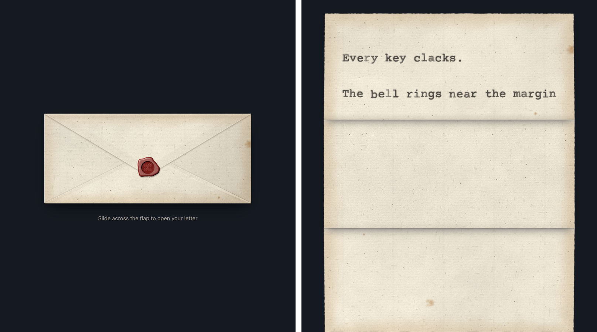
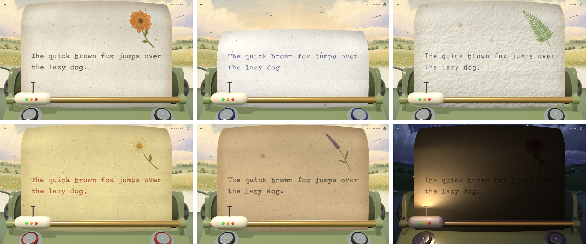

<p align="center">
  
</p>

<h1 align="center">TypeWrite <sub>by Jericho</sub></h1>

<p align="center">
  A typewriter in your browser, on your Mac and on your iPhone.<br>
  Every key clacks, the bell rings near the margin, and the ink sits in old paper like the real thing.
</p>

<p align="center">
  <a href="https://msreeganeshnaik.github.io/TypeWrite/"><b>Type in your browser</b></a> · <a href="#install-on-your-mac-and-iphone"><b>Install on your Mac and iPhone</b></a>
</p>

<p align="center">
  
</p>

## Two ways to type

| | Where | What you get |
|---|---|---|
| **Browser** | [msreeganeshnaik.github.io/TypeWrite](https://msreeganeshnaik.github.io/TypeWrite/) | Nothing to install. Type, then save the sheet as a picture or the words, or send it as a sealed letter. Sheets stay in that browser. |
| **Mac and iPhone** | One line in Terminal on a Mac (below) | The same machine in its own window: in your Applications folder, and on your iPhone when it's plugged in, with real haptics and the share sheet. Sheets stay on each device. |

## In the browser

Open [msreeganeshnaik.github.io/TypeWrite](https://msreeganeshnaik.github.io/TypeWrite/) and start typing (on a phone, tap the page).

<p align="center">
  
</p>

- **The page and the machine are drawn in three.js.** Aged paper with fibres, specks, foxing and browned edges, in five stocks (old paper, bond, onionskin, canary second sheet, kraft); a cloth-ribbon weave in every letter, ragged where the ink soaked in. The platen, knobs, rod and type guide are lit like enamel and brass, and every typebar has faults of its own.
- **The view** behind the machine is a painted meadow: clouds that drift, small birds, birdsong by day; stars, fireflies and crickets at night. The desk lamp turns the day to night and lights the page.
- **The dock:** feed a new sheet, typeface, size and line spacing, alignment for each paragraph, title, pressed flower, paper, ribbon, the lamp, and sound.
- **Share:** a picture of the sheet (long sheets go out as full-size pages), the words as a .txt, or **a letter**: the sheet tears out of the machine, folds in three and is sealed in an envelope of the same paper, as one HTML file anyone can open. They tear the flap open with a finger and the letter unfolds. Ctrl+S (⌘S) opens it.
- **Read back** by dragging or flicking the page, or with the arrow keys, Page Up/Down, Home and End.
- Without WebGL it falls back to a flat 2D drawing of the same page.

## Install on your Mac and iPhone

Paste this into Terminal on your Mac:

```bash
curl -fsSL https://raw.githubusercontent.com/MSreeGaneshNaik/TypeWrite/main/install.sh | bash
```

It downloads the source, builds TypeWrite on your Mac with Xcode, and installs it:

- **On your Mac**, in Applications (macOS 14 Sonoma or later). It's the same app, built for the Mac with Mac Catalyst, and signed to run on your Mac only, so it needs no Apple ID.
- **On your iPhone too**, if it's plugged in with a cable, unlocked and trusted. The app is signed with your own Apple ID; a free one works.

No account with us, no dependencies, nothing uploaded. The first build takes a few minutes.

TypeWrite needs **Xcode 16 or later** (free in the Mac App Store). If it's missing, the installer opens the App Store for you; open Xcode once when it's installed, then run the same line again. To install on an iPhone, add your Apple ID in **Xcode → Settings → Accounts** and turn on **Developer Mode** on the phone (**Settings → Privacy & Security**). The first time, iOS also asks you to trust the app: **Settings → General → VPN & Device Management → Apple Development → Trust**.

### Update

Run the same line again. It compares the version you have with the latest on GitHub:

- **Same version:** it says **TypeWrite is up to date** and just opens TypeWrite.
- **Newer version on GitHub:** it downloads, rebuilds and reinstalls in place. Your sheets are kept.
- **iPhone signed with a free Apple ID:** iOS stops opening the app after 7 days. Running the line again after 6 days re-signs it, so it keeps working.

| Put this in front of `bash` | To |
|---|---|
| `TYPEWRITE_FORCE=1` | Rebuild even when you're up to date |
| `TYPEWRITE_TARGET=mac` | Only the Mac app, even with an iPhone plugged in |
| `TYPEWRITE_TARGET=iphone` | Only the iPhone, and say what's missing if it can't |
| `TYPEWRITE_TARGET=simulator` | Only the iPhone Simulator |
| `TYPEWRITE_APPS=~/Applications` | Put the Mac app in this folder instead of /Applications |

For example: `curl -fsSL … | TYPEWRITE_FORCE=1 bash`.

## How it works

| You | TypeWrite |
|---|---|
| Feed a new sheet | The paper rolls up into the machine with a ratchet sound |
| Type a key | The letter strikes one fixed point under a steel bail; the sheet slides one cell left on a spring, with a clack and a tap |
| Reach the last six columns | The bell rings and the type guide's dots turn red |
| Run past the margin | The word you're typing wraps to the next line, the way a typist would |
| Press Return | The carriage swings back and the sheet rolls up a line, with a heavier knock |
| Tap the paper | Stop typing: the sheet slides to the centre so you can read whole lines; drag to look back |
| Share | A picture, the words, or a sealed letter that tears open |

<p align="center">
  
</p>

## Papers

<p align="center">
  
</p>

| Paper | What it's like |
|---|---|
| **Old paper** | Cream laid paper with fibres, specks and foxing. Every sheet ages in its own way. |
| **Bond** | Twenty-pound cotton bond. The ribbon's ink wicks into the rag fibres. |
| **Onionskin** | Thin, rag-strong and cockled, made for carbon copies. Hold it to the light and the machine shows through. |
| **Second sheet** | The yellow manifold stock that took the carbon copy under the top sheet. |
| **Kraft** | Brown, coarse and full of fibres. The ink soaks in deepest here. |

**Ribbons:** black, red, blue, worn, film and carbon copy. A cloth ribbon prints its weave into every letter, film prints crisp and even, and carbon copy prints soft and smudged.

**Typefaces:** Pica, Elite, Office and Gothic. **Pressed flowers:** marigold, rose, lavender, fern and daisy.

## What's on the desk

- **Ink that looks struck.** Every letter is nudged, tilted and inked a little differently, with a faint second impression for bleed and the occasional light or heavy strike. The pattern is seeded per sheet, so a page never shimmers when it redraws.
- **Sounds** for keys (four variations), the space bar, the margin bell, carriage return, backspace and paper feed, each pitched a few percent differently every time.
- **A real machine's rules:** 30 columns, a bell 6 columns before the margin, no autocorrect, no predictions, straight quotes. Hardware keyboards work, including ⌘V.
- **Private.** Your sheets stay on your device, in the browser or in the app. TypeWrite has no accounts and no tracking. Sheets typed in the earlier all-native app move into the new one by themselves the first time it opens.

## Uninstall

On the Mac, drag TypeWrite from Applications to the Bin. On the iPhone, press and hold TypeWrite → **Remove App**. In the Simulator:

```bash
xcrun simctl uninstall booted com.jericho.typewrite
rm -rf ~/Library/"Application Support"/TypeWrite   # the installer's build cache
```

## Build from source

The browser version and the app share one source, in [`web`](web). Building it writes the GitHub Pages page (`index.html`) and the app's page (`TypeWrite/Resources/TypeWrite.html`):

```bash
git clone https://github.com/MSreeGaneshNaik/TypeWrite.git
cd TypeWrite/web
npm install && npm run build
cd .. && python3 -m http.server 8766    # then open http://127.0.0.1:8766
open TypeWrite.xcodeproj                 # the Mac and iPhone app: pick a device and press ⌘R
```

| Folder | What's in it |
|---|---|
| [`web/src`](web/src) | The machine: the typing engine (`z-engine.js`), the sheet and ink (`z-sheet.js`), the paper and meadow shaders, the three.js scene (`gl.js`), the app itself (`app-main.js`) and the letter (`letter.html`) |
| [`web`](web) | `template.html` and `app.css`; `assemble.mjs` and `build-site.mjs`, which build the pages; `assets` (three.js r149, the meadow and night recordings, the letter's sounds) |
| [`web/tests`](web/tests) | Browser checks with Playwright: the engine's rules, sending and opening a letter, long sheets, the tear's sound |
| [`index.html`](index.html) | The browser version, built, served by GitHub Pages from the repository root |
| [`TypeWrite`](TypeWrite) | The Mac and iPhone app: a native window around `Resources/TypeWrite.html`, with haptics, the share sheet and the move of older sheets |
| [`ShellTests`](ShellTests) | Tests for the app's own Swift: the move of older sheets into the page (`swift test`) |
| [`TypeWrite/Resources`](TypeWrite/Resources) | The typewriter sounds (with their credits) and the typefaces with their licences, used by both versions |
| [`Branding`](Branding) | The app icon and Jericho tile as pure vector SVGs |
| [`assets`](assets) | The README media, drawn by the real page in Chrome on a Mac's GPU: the demo as an animated WebP, a retina screenshot, the papers grid and the letter |
| [`Tools`](Tools) | `make_sounds.py` and `make_icons.py`, which regenerate the sounds and icons; `ci/build-apps.sh`, which CI runs on every push to build the app for the iPhone Simulator and the Mac |

## Credits

TypeWrite is made by Jericho, and the petal mark is Jericho's. The idea of a typewriter notes app was inspired by Platen; TypeWrite is an independent, from-scratch implementation with its own code, art and sounds. The sounds are cut from real manual typewriters by `Tools/make_sounds.py`: the keys, space, backspace and jam are Erik Pålsson's recordings of an Underwood 315 and an Olivetti Dora for [Sounds of Changes](http://www.soundsofchanges.eu) (CC BY 4.0); the bell, return and paper feed are CC0 recordings by knufds and others via [js-typewriter](https://github.com/pbinkley/js-typewriter). Full credits are in [`CREDITS-Sounds.txt`](TypeWrite/Resources/Sounds/CREDITS-Sounds.txt). Typefaces: Courier Prime and Cutive Mono and Lekton (SIL Open Font License 1.1), and Special Elite (Apache License 2.0). The meadow: birdsong by Thimras (CC0) and crickets by dklon (CC BY 3.0); the letter's paper tear by OwlishMedia (CC0) and its folds and slides from Kenney (CC0), all via OpenGameArt and Kenney.nl. TypeWrite uses [three.js](https://threejs.org) (MIT).
